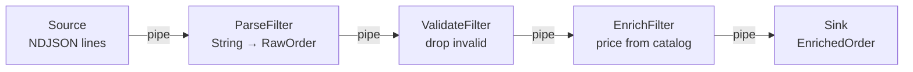

# Template.PipeAndFilter

Production-grade **pipe-and-filter** architecture template. A concurrent
order-ingestion pipeline in Rust: raw NDJSON order events flow through a chain of
independent **filters** connected by **pipes** (bounded channels), getting
parsed, validated and enriched into clean `EnrichedOrder` records.

One of a family of architecture templates (see the
[`core-apis` catalog](../README.md)) modelling the same `Orders` domain.

## What "pipe-and-filter" means here



- **Uniform interface** — every stage implements the same `Filter` trait
  (`src/pipeline`): `process(item) -> Vec<Out>` where `0` outputs = filtered out,
  `1` = mapped, `n` = expanded.
- **Pipes** — stages are connected by **bounded** `tokio::mpsc` channels. Each
  filter runs as its own task (concurrency), and bounded channels give
  **backpressure**: a slow stage blocks its predecessor instead of blowing up
  memory.
- **Composability** — filters are independent and reorderable as long as the
  in/out types line up; add a stage by inserting another channel + `spawn_stage`.
- **Graceful shutdown** — closing the source channel propagates stage by stage
  down the pipe.

The stages: `Parse` (drops malformed JSON) → `Validate` (drops orders with no
customer/empty items/non-positive quantities) → `Enrich` (looks up name + price
per SKU from a catalog, computes the total; drops orders with unknown SKUs).

## When to use it / trade-offs

| ✅ Good fit | ⚠️ Watch out |
|---|---|
| Stream/batch data processing, ETL, ingestion | Not for request/response APIs |
| Stages you want to reuse, reorder, or test in isolation | Per-item overhead if stages are tiny |
| Natural parallelism + backpressure | Global/shared state fights the model |
| Clear, inspectable dataflow | Error/partial-failure policy needs deliberate design |

## Project structure

```
src/
  pipeline/mod.rs   # Filter trait + spawn_stage runner (bounded channels)
  filters/mod.rs    # ParseFilter, ValidateFilter, EnrichFilter
  domain.rs         # RawOrder, EnrichedOrder, Line
  catalog.rs        # enrichment data source (sku -> name/price)
  lib.rs            # run_orders_pipeline (assembly)
  main.rs           # CLI: stdin/file -> stdout
tests/pipeline.rs   # end-to-end pipeline tests
sample-orders.ndjson
```

## Setup & run

Requires Rust (stable).

```bash
cat sample-orders.ndjson | cargo run
# or
cargo run -- sample-orders.ndjson
# enriched orders go to stdout; a summary + dropped-record warnings to stderr
RUST_LOG=warn cargo run -- sample-orders.ndjson
```

With Docker:

```bash
docker build -t pipe-and-filter .
cat sample-orders.ndjson | docker run -i --rm pipe-and-filter
```

## Testing

```bash
cargo test                      # full-pipeline tests (drops + enrichment)
cargo clippy -- -D warnings
cargo fmt --check
```

## License

MIT — see [LICENSE](./LICENSE).
